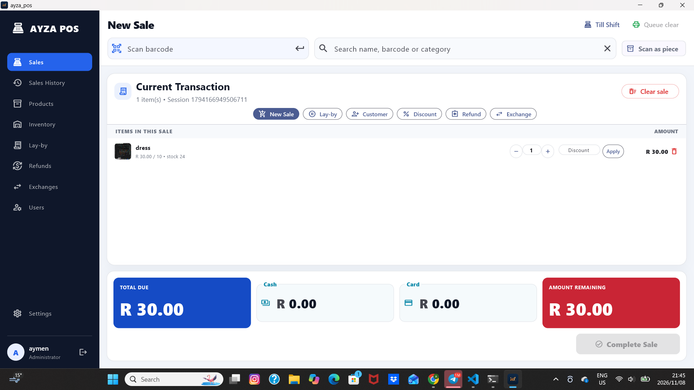
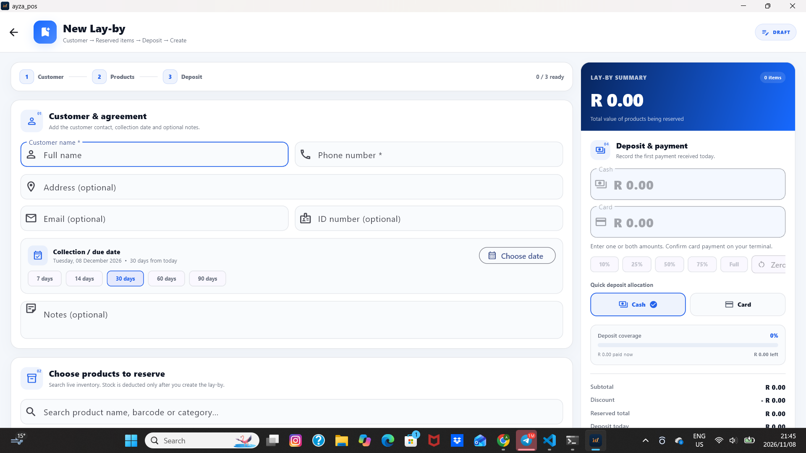
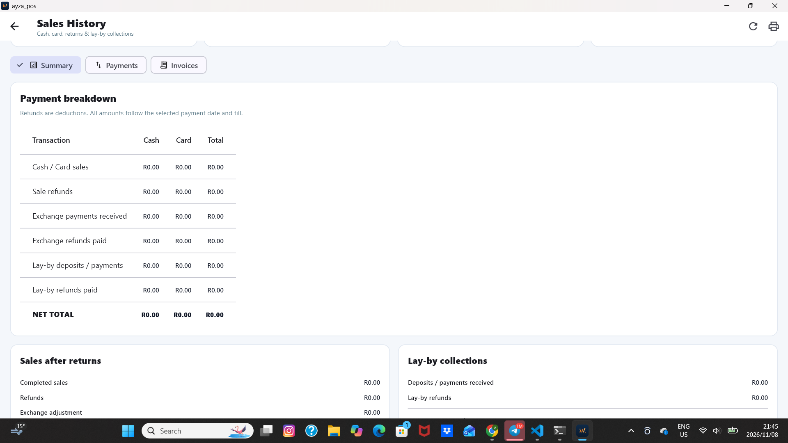

# AYZA POS

**An offline-first point-of-sale system for Windows retail.**

Built for small shops in South Africa and Ethiopia, where a till that needs an
internet connection is a till that stops. Every sale commits locally; nothing on
the path between scanning an item and opening the cash drawer touches a network.

> **Source is private.** This repository is a showcase: screenshots, design notes
> and the engineering decisions behind the product. The application is a
> commercial product sold to shops. Happy to walk through the code in an
> interview or a screen share.

**Role:** sole developer — product design, Flutter application, offline licensing
system, Windows installer.

**[Read the full case study →](https://aymenkedir.github.io/ayza-pos-showcase/)**

---

## The till

One row per cart line, so a full basket stays on screen while the cashier works.

Cash and card are split on a single line, and the card field is capped at
whatever cash has not already covered — **a card payment can never produce
change**, which is the rule a real card terminal enforces. The cap is applied in
the UI and again before the sale is written: the first is a courtesy, the second
is the rule.

## Lay-by

Goods reserved and paid off over weeks — how a large share of clothing and
furniture is actually bought here. The deposit is allocated across cash and card
and measured against the reserved total. Stock is deducted only once the
agreement is created, never while the form is still open.

## Reconciliation

What the owner counts at close. Sales, refunds, exchanges in both directions and
lay-by collections, reconciled per till and per day, split by cash and card, down
to one net total — the number that has to match the cash drawer.

---

## Engineering notes

### Offline first

Every sale is one atomic SQLite transaction: the sale, its lines, the payment
split, the stock deduction and the stock movement all commit together or not at
all.

The database lives in the application support folder rather than beside the
executable, so a desktop shortcut, a reinstall or an update never separates a
shop from its sales. An earlier build kept it on a path relative to the working
directory, which meant the data appeared to vanish the first time anyone opened
the app from a shortcut.

### Money

All amounts are handled as integer cents. Floating point never touches a total,
a split or a change calculation.

Card is capped at `total − cash`. Cash may overpay and produce change; card may
not.

### Box pricing

One product sells as a single piece or as a full box, each with its own price,
out of one shared stock count. The two live as separate cart lines over the same
product, and stock is checked across both before either can grow.

At checkout every line is converted back to pieces, with the box saving carried
as a discount. Stock, reports and refunds stay on a single unit no matter how the
item was sold — which meant adding box selling without migrating a single table.

### Printing

Receipts and 50 × 32 mm barcode labels go to Xprinter hardware through raw Win32
printing — `dart:ffi` into `winspool.drv` — so ESC/POS and TSPL reach the printer
as bytes rather than as a rendered page.

Printing is deliberately off the critical path. A receipt that fails goes into a
queue that survives a restart, and the next customer is served immediately. A
printer problem must never hold up a till.

### Offline licensing

Lifetime licences are signed with Ed25519 and bound to the machine's Windows
GUID. The private key never leaves an encrypted PKCS#8 vault on the issuing
computer; the application ships public keys only and verifies with no server
involved.

Keys are **additive**: a new signing key is added to the application's trusted
set rather than replacing the old one. Rotating a key can never lock out a shop
that is already running — a property that only becomes obvious the first time a
key changes.

### Roles and attribution

Cashiers, supervisors and the owner see different screens. Refunds, price
changes, stock reductions and user management are each gated on a permission, and
every sale, removed line and cleared cart is recorded against the signed-in user.

---

## Stack

| | |
|---|---|
| **Application** | Flutter · Dart 3 · Riverpod · SQLite (`sqflite_common_ffi`) |
| **Platform** | Windows desktop · `dart:ffi` → Win32 · `pdf` / `printing` |
| **Licence issuer** | Python · Tkinter · Ed25519 · encrypted SQLite vault |
| **Delivery** | Inno Setup installer · LAN tills · Xprinter XP-360B / XP-420B |

---

## Status

| | |
|---|---|
| ✅ | Sales, lay-by, refunds, exchanges, inventory, users, reconciliation |
| ✅ | Offline activation, Windows installer, first shop running |
| ◻ | Box units printed on the receipt rather than reconciled as a discount |
| ◻ | Multi-till testing over LAN against one licensed main computer |

---

## Contact

**Aymen Kedir** — Flutter / mobile and desktop developer
Pretoria, South Africa · open to remote work

- aymenkedir816@gmail.com
- [linkedin.com/in/ayzatechz](https://www.linkedin.com/in/ayzatechz)
